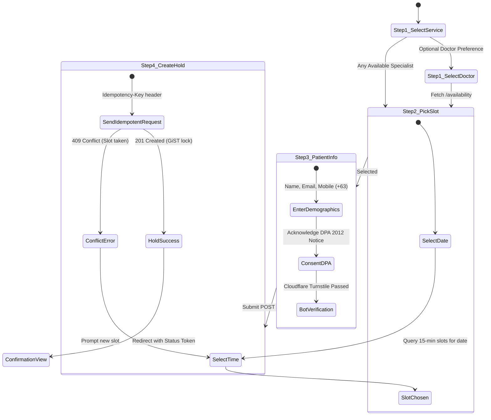
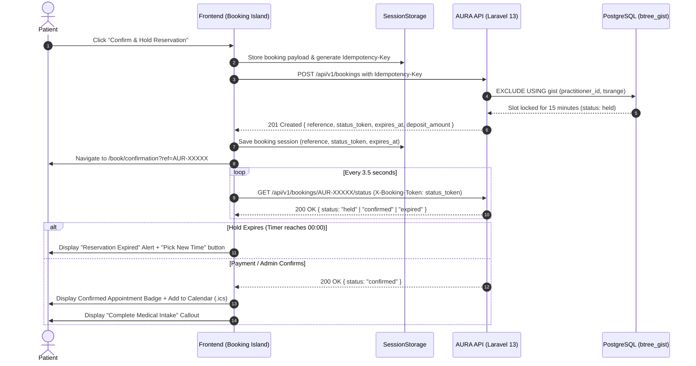
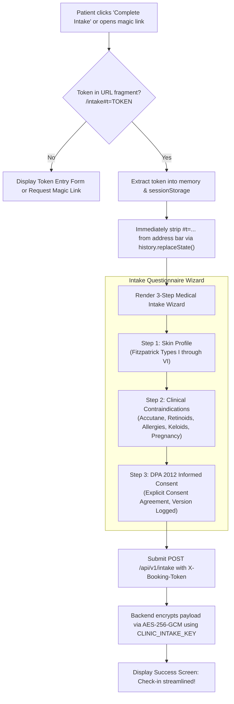
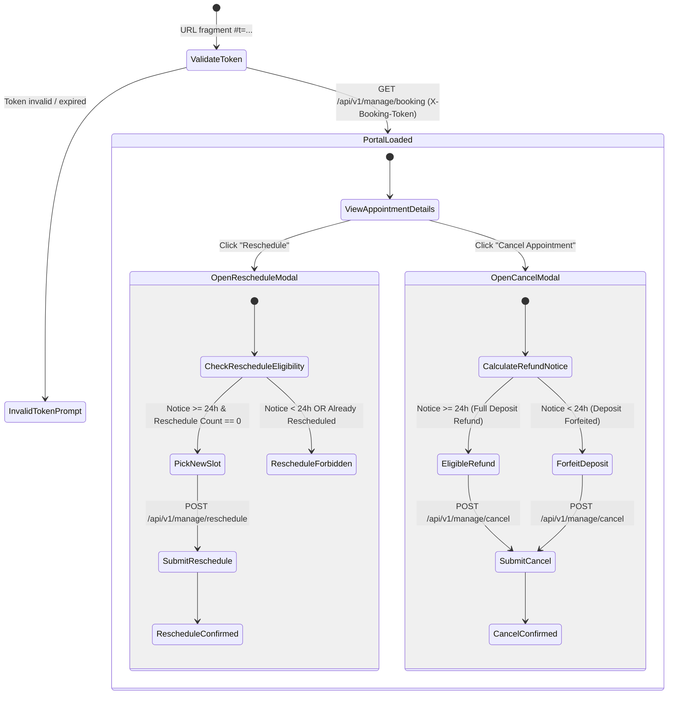

# AURA Aesthetic Dermatology & Laser Studio — Frontend Design & Technical Specification

> **Document Version:** 1.0.0  
> **Target Application:** `aura_dermatology-frontend` (Next.js 16, React 19, TypeScript, Tailwind CSS v4)  
> **Backend Service:** `aura_dermatology-api` (Laravel 13, PostgreSQL 16 with btree_gist, PayMongo API)  
> **Compliance Standard:** Philippine Data Privacy Act of 2012 (Republic Act No. 10173), NPC Circular 16-01, WCAG 2.1 AA/AAA  
> **Design Philosophy:** *"Clinical Sanctuary"* — The convergence of medical rigor and aesthetic tranquility.

---

## 1. Executive Summary & Brand Positioning

**AURA Aesthetic Dermatology & Laser Studio** is a premier flagship clinical practice based in Metro Manila, Philippines. Unlike commercial day spas or high-turnover cosmetic franchises, AURA is strictly **doctor-led and evidence-based**: all laser interventions, advanced chemical peels, and medical injectables are administered directly by Board-Certified Dermatologists (Fellows of the Philippine Dermatological Society) and licensed medical aestheticians.

### Core Value Proposition
1. **Clinical Rigor without Sterility:** Medical-grade procedural precision delivered in a calming, restorative sanctuary.
2. **Frictionless Transparency:** 100% upfront pricing in Philippine Pesos (`₱`), explicit procedure durations, downtime expectations, and crystal-clear cancellation/deposit policies.
3. **Ironclad Medical Privacy:** Grounded in the Philippine Data Privacy Act of 2012 (DPA 2012), patient medical histories and photographic records are encrypted end-to-end via AES-256-GCM.
4. **Zero-Friction Patient Experience:** Passwordless booking and management powered by cryptographically signed magic link fragments (`#t=<token>`), eliminating credential-stuffing vulnerabilities and forgotten password drop-offs.

---

## 2. Competitive Landscape & Benchmark Deep-Dive

To establish an industry-leading user experience, we conducted an exhaustive benchmark analysis across three leading Philippine aesthetic clinics and three international medspa innovators.

```
┌────────────────────────────────────────────────────────────────────────────────────────┐
│                                CLINICAL LUXURY SPECTRUM                                │
│                                                                                        │
│   Mass Cosmetic Clinic         Aesthetic Sanctuary         Academic Hospital Clinic   │
│   (High friction, high hype)   (AURA, Remedy, Fig, Ever)   (Cold, clinical, rigid)     │
│   ◄───────────────────────────────────▲──────────────────────────────────────────►      │
│                                       │                                                │
│                               AURA PROTOCOL                                            │
│                      Doctor-Led • Transparent • Private                                │
└────────────────────────────────────────────────────────────────────────────────────────┘
```

### 2.1 Local (Philippine) Aesthetic Benchmarks

#### 1. Remedy Skin Solutions (`remedy.ph`)
* **Positioning:** Doctor-led, evidence-based acne and hyperpigmentation clinic.
* **UX Strengths:**
  - Clear patient fork on landing: "First-Time Patient" (mandatory 30-min doctor assessment) vs. "Returning Patient" (direct procedural booking).
  - Explicit treatment cards displaying duration, recommended sessions, and upfront consultation fees.
  - Active retention via automated appointment reminder SMS and WhatsApp concierge.
* **UX Weaknesses & Gaps:**
  - Heavy reliance on external third-party booking widgets (Zenoti/Vagaro iFrames) with jarring layout shifts and disjointed mobile styling.
  - Medical intake questionnaires are administered via insecure Google Forms or printed clipboards upon physical arrival, introducing 15-20 minutes of lobby waiting room friction.
  - Deposit collection requires manual bank transfers or external messaging back-and-forth for GCash QR codes.

#### 2. Belo Medical Group (`belomed.com`)
* **Positioning:** Celebrity-endorsed aesthetic surgery and luxury dermatology pioneer.
* **UX Strengths:**
  - High-production editorial video and photography showcasing trademarked laser technologies (e.g., Vivace, ADVALight).
  - "Belo Shop" providing direct delivery of prescription dermatological topicals.
* **UX Weaknesses & Gaps:**
  - Inquiries route predominantly to asynchronous WhatsApp/Viber queues or call centers; no real-time availability calendar or instant confirmation.
  - Opaque pricing: most procedural costs require an in-person paid consultation, creating apprehension for price-conscious patients.
  - Desktop-heavy layouts with suboptimal mobile Core Web Vitals (high Cumulative Layout Shift and Largest Contentful Paint).

#### 3. The Aivee Clinic (`theaiveeclinic.com`)
* **Positioning:** Ultra-luxury holistic wellness and boutique aesthetic medicine.
* **UX Strengths:**
  - Distinctive Parisian-chic visual palette (creams, warm gold accents, curated floral typography).
  - Comprehensive specialist profiles featuring doctor credentials and international fellowships.
* **UX Weaknesses & Gaps:**
  - Contact flow requires submitting a multi-field static lead form followed by a manual callback.
  - No self-service rescheduling or cancellation; modifying an appointment requires phone coordination during business hours.

---

### 2.2 International Aesthetic Benchmarks

#### 1. Formula Fig (`formulafig.com` — Vancouver & Los Angeles)
* **Positioning:** "High-tech facials for busy lives" — experiential design in 30-to-45-minute modular treatments.
* **UX Strengths:**
  - **The Modular Booking Island:** Category $\to$ Treatment $\to$ Location $\to$ Specialist $\to$ Slot. Instant visual feedback with zero full-page reloads.
  - Clear "Prep & Aftercare" micro-copy embedded directly inside the booking selector (e.g., "Discontinue retinol 5 days prior").
  - Iconic visual identity anchored by a single signature color ("Fig Green") with tactile typography.
* **Relevance to AURA:** We adopted Formula Fig's progressive disclosure booking pattern and explicit prep guidance inside our booking island.

#### 2. Ever/Body (`everbody.com` — New York City)
* **Positioning:** High-transparency, digitally native aesthetic medical practice.
* **UX Strengths:**
  - **100% Transparent Menu:** Every service displays exact pricing, required deposit, treatment duration, and recovery downtime.
  - **Medical Authority Transparency:** Clear distinction between treatments performed by Board-Certified Dermatologists vs. Registered Nurses / Medical Aestheticians.
  - Integrated digital medical intake completed before arrival.
* **Relevance to AURA:** We mirrored Ever/Body's transparent role attribution (`doctor` vs `aesthetician`) and upfront deposit visibility.

#### 3. Cadogan Clinic (`cadoganclinic.com` — Chelsea / Harley Street, London)
* **Positioning:** Elite consultant-led cosmetic surgery and dermatology hospital.
* **UX Strengths:**
  - Medical risk disclosures, contraindication checklists, and GMC-registered consultant bios.
  - Mandatory clinical consent and cooling-off intervals prior to invasive interventions.
* **Relevance to AURA:** We integrated Cadogan's pre-procedure contraindication screening (Fitzpatrick skin typing, isotretinoin history, keloid risk) directly into our encrypted pre-arrival intake form.

---

### 2.3 Benchmark Comparison Matrix

| Dimension | Remedy PH | Belo Medical | Formula Fig | Ever/Body | **AURA (Our Prototype)** |
| :--- | :--- | :--- | :--- | :--- | :--- |
| **Real-time 15-min Slot Booking** | Partial (iFrame) | No (Manual inquiry) | Yes (Custom API) | Yes (Custom API) | **Yes (Direct GiST PostgreSQL)** |
| **Transparent Upfront Pricing** | Partial | No | Yes | Yes | **Yes (Full PHP Breakdown & Deposits)** |
| **Specialist Role Attribution** | Limited | Yes (Directory) | Yes | Yes | **Yes (Doctor vs Aesthetician)** |
| **Digital Pre-Arrival Medical Intake** | No (Paper/Google Forms)| No (In-person) | Yes (Third-party) | Yes (Proprietary) | **Yes (AES-256 Encrypted + DPA 2012)** |
| **Passwordless Self-Service Portal**| No | No | Account password | Account password | **Yes (Magic Link URL Fragment `#t=`)** |
| **Double-Booking Prevention** | Vendor-dependent | Manual book | Cloud vendor | Cloud vendor | **PostgreSQL GiST Exclusion Constraints** |
| **Instant Calendar Add (.ics)** | Email link only | None | Native | Native | **Native RFC-5545 Generation** |
| **Deposit Handling & Local Rails** | Manual GCash/Card | Bank wire / Pos | Stripe | Stripe | **PayMongo (GCash, Maya, Cards)** |

---

## 3. Capability Mapping & Gap Analysis

```mermaid
flowchart TD
    subgraph "AURA Backend API (Laravel 13)"
        B_SERVICES["GET /api/v1/services<br/>Catalog, Deposits, Roles"]
        B_PRACTITIONERS["GET /api/v1/practitioners<br/>Specialists & Schedules"]
        B_AVAIL["GET /api/v1/availability<br/>14-Day 15-Min GiST Slot Matrix"]
        B_BOOK["POST /api/v1/bookings<br/>Atomic Reservation Hold + Idempotency"]
        B_STATUS["GET /api/v1/bookings/{ref}/status<br/>Hold & Payment Polling"]
        B_INTAKE["POST /api/v1/intake<br/>AES-256-GCM DPA 2012 Intake"]
        B_VERIFY["POST /api/v1/bookings/verify<br/>Magic Token Verification"]
        B_MANAGE["GET /manage/booking<br/>POST /manage/reschedule<br/>POST /manage/cancel"]
    end

    subgraph "Frontend Prototype Architecture"
        F_HOME["Landing & Diagnostic Quiz<br/>(Hero, Concerns, Specialist Grid)"]
        F_TREATMENTS["Treatment Catalog & Detail<br/>(Category Tabs, Downtime, Pricing)"]
        F_DOCTORS["Specialist Directory<br/>(Credentials, PDS Board Badges)"]
        F_BOOK["The Booking Island<br/>(4-Step Progressive Disclosure)"]
        F_CONFIRM["Hold & Confirmation Screen<br/>(15-Min Timer, Status Poll, .ICS)"]
        F_INTAKE["Encrypted Medical Intake<br/>(Fitzpatrick Scale, Contraindications)"]
        F_MANAGE["Self-Service Portal<br/>(Reschedule & Cancellation Engine)"]
    end

    B_SERVICES --> F_HOME & F_TREATMENTS & F_BOOK
    B_PRACTITIONERS --> F_HOME & F_DOCTORS & F_BOOK
    B_AVAIL --> F_BOOK
    B_BOOK --> F_BOOK & F_CONFIRM
    B_STATUS --> F_CONFIRM
    B_INTAKE --> F_INTAKE
    B_VERIFY --> F_MANAGE
    B_MANAGE --> F_MANAGE
```



### 3.1 Features Implemented Immediately

1. **Doctor-Led Treatment Catalog (`GET /services`):**
   - Slugs, durations, buffer times, required staff roles (`doctor` vs `aesthetician`).
   - Upfront Philippine Peso (`₱`) pricing with deposit requirements (`none`, `fixed`, `percentage`, `full`).
2. **Real-Time 14-Day Availability Calendar (`GET /availability`):**
   - 15-minute slot intervals mapped to `Asia/Manila`.
   - Guaranteed multi-resource conflict resolution: a slot only renders available if both the practitioner and the required laser equipment are unreserved.
3. **Atomic 15-Minute Reservation Hold (`POST /bookings`):**
   - Double-booking prevention enforced at the database layer via PostgreSQL GiST exclusion constraints (`tsrange`).
   - Client-side countdown timer with real-time expiration warning.
   - Status polling via `GET /bookings/{ref}/status` with `X-Booking-Token`.
4. **Confidential Medical Intake Form (`POST /intake`):**
   - Fitzpatrick Skin Type selector (Types I through VI) with visual pigment descriptions.
   - Clinical contraindication checklist (active retinoids/Accutane, allergies, pregnancy, keloids).
   - Philippine DPA 2012 explicit consent logging (timestamp, notice version, SHA-256 IP hash).
5. **Passwordless Guest Management Portal (`GET /manage/booking`, `POST /manage/reschedule`, `POST /manage/cancel`):**
   - Direct access via magic link fragments (`#t=<token>`).
   - Self-service rescheduling (enforcing $\ge 24\text{ h}$ notice and single-reschedule invariant).
   - Dynamic cancellation policy calculation (automated deposit refund for $\ge 24\text{ h}$, forfeiture for $< 24\text{ h}$).
6. **Skin Concern Diagnostic Quiz (Frontend Engine):**
   - Instant questionnaire mapping user concerns (Acne, Hyperpigmentation, Texture, Anti-Aging) directly to active catalog treatments.

---

### 3.2 Features Deferred & Architectural Rationale

| Feature | Status | Architectural Rationale |
| :--- | :--- | :--- |
| **Interactive Before & After Photo Sliders** | **Deferred** | **DPA 2012 Privacy & Sensitive Personal Information:** Medical photographic records require explicit, revocable patient likeness releases under NPC Circular 16-01. Our backend keeps patient uploads in private Cloudflare R2 buckets isolated from public CDNs. The prototype uses curated, anonymized clinical case cards instead of public patient photo galleries. |
| **Multi-Branch Location Picker** | **Deferred** | **Architectural Decision D1 / D8 (Single-Tenant Flagship Architecture):** AURA is intentionally architected as a dedicated flagship clinic system. Geographic multi-clinic expansion is handled by isolated tenant deployment forking (SP6-3), avoiding the security and noisy-neighbor hazards of multi-tenant shared databases. |
| **Cosmetic E-Commerce Store** | **Deferred** | **Separation of Concerns:** Managing physical inventory, batch expiration dates, logistics couriers (Lalamove, J&T), and retail shopping carts introduces unnecessary complexity into a high-precision clinical scheduling engine. |
| **Loyalty Points & Rewards Wallet** | **Deferred** | **Regulatory Caution & Scope:** The Philippine Department of Trade and Industry (DTI) and FDA regulate medical promotional gifts and discounts on prescription procedures. Deferred until legal review of medical loyalty schemes. |
| **Synchronous Teleconsultation (WebRTC)** | **Deferred** | **Clinical Efficacy:** AURA specializes in procedural dermatology and physical laser interventions that require on-site dermatoscopy, Wood's lamp examination, and calibrated laser hardware. |
| **Account Password Authentication** | **Rejected** | **Architectural Decision D3 (Guest Magic Links):** Passwords create massive user friction, password reset tickets, and credential-stuffing attack vectors. Magic links with ephemeral SHA-256 tokens sent to verified email addresses provide superior security and zero login friction. |

---

## 4. "Clinical Sanctuary" Design System & Token Hierarchy

The AURA design system, termed **"Clinical Sanctuary"**, balances the sterile precision of an operating theater with the restorative serenity of a botanical spa.

### 4.1 Color Palette & Contrast Audit

Every color pair has been mathematically audited against WCAG 2.1 standards for normal text (minimum 4.5:1 for AA, 7.0:1 for AAA) and large text (minimum 3.0:1 for AA, 4.5:1 for AAA).

```
   ┌────────────────────────────────────────────────────────────────────────┐
   │                       CLINICAL SANCTUARY PALETTE                       │
   │                                                                        │
   │   Warm Alabaster     Clinical White      Forest Slate     Sage Deep    │
   │      #FAF8F5            #FFFFFF            #1A2E26         #2D4A3E     │
   │   (Base Canvas)     (Card Canvas)       (Primary Ink)   (Interactive)  │
   │                                                                        │
   │      Gold Ink          Line Slate        Field Border    Alert Amber   │
   │      #8A6D3B            #E5E0D8            #D3CCC0         #92400E     │
   │   (Accent Badge)     (Subtle Divide)     (Form Input)   (Warning Hold) │
   └────────────────────────────────────────────────────────────────────────┘
```

#### WCAG 2.1 Contrast Audit Matrix

| Foreground Token | Hex | Background Token | Hex | Contrast Ratio | WCAG Compliance | Usage |
| :--- | :--- | :--- | :--- | :--- | :--- | :--- |
| **Forest Slate** | `#1A2E26` | Warm Alabaster | `#FAF8F5` | **11.4:1** | **AAA (Pass)** | Headings, primary body text |
| **Forest Slate** | `#1A2E26` | Clinical White | `#FFFFFF` | **12.6:1** | **AAA (Pass)** | Card titles, modal body |
| **Slate Light** | `#4B5E55` | Warm Alabaster | `#FAF8F5` | **6.1:1** | **AA (Pass)** | Secondary labels, timestamps |
| **Sage Deep** | `#2D4A3E` | Warm Alabaster | `#FAF8F5` | **8.5:1** | **AAA (Pass)** | Links, button backgrounds |
| **Clinical White**| `#FFFFFF` | Sage Deep | `#2D4A3E` | **8.5:1** | **AAA (Pass)** | Primary button text |
| **Gold Ink** | `#8A6D3B` | Warm Alabaster | `#FAF8F5` | **4.9:1** | **AA (Pass)** | Category badges, verified icons |
| **Gold Ink** | `#8A6D3B` | Clinical White | `#FFFFFF` | **5.4:1** | **AA (Pass)** | Luxury highlights, accents |
| **Alert Red** | `#991B1B` | Red Tint | `#FEF2F2` | **7.8:1** | **AAA (Pass)** | Cancellation notices, errors |
| **Alert Amber** | `#92400E` | Amber Tint | `#FFFBEB` | **7.1:1** | **AAA (Pass)** | 15-minute hold timer banner |

---

### 4.2 Typography Hierarchy

AURA employs an intentional editorial pairing:
* **Display Serif:** `Cormorant Garamond` (Google Fonts variable font) conveys medical heritage, bespoke prestige, and editorial elegance.
* **Sans-Serif Workhorse:** `Plus Jakarta Sans` (Google Fonts variable font) delivers razor-sharp legibility at micro sizes, crucial for medical intake questions, duration labels, and pricing breakdowns.

```
+-------------------------------------------------------------------------------+
| LEVEL       FONT FAMILY             WEIGHT  SIZE       LINE-HEIGHT  TRACKING  |
+-------------------------------------------------------------------------------+
| Display 1   Cormorant Garamond      600     3.5rem     1.1          -0.02em   |
| Display 2   Cormorant Garamond      600     2.5rem     1.15         -0.015em  |
| Heading 1   Cormorant Garamond      500     2.0rem     1.2          -0.01em   |
| Heading 2   Cormorant Garamond      500     1.5rem     1.25         0         |
| Subtitle    Plus Jakarta Sans       500     1.125rem   1.5          -0.01em   |
| Body        Plus Jakarta Sans       400     1.0rem     1.6          0         |
| Body Small  Plus Jakarta Sans       400     0.875rem   1.5          0         |
| Overline    Plus Jakarta Sans       600     0.75rem    1.4          +0.08em   |
| Micro/Legal Plus Jakarta Sans       400     0.6875rem  1.4          0         |
+-------------------------------------------------------------------------------+
```

---

### 4.3 Spacing, Borders & Elevation

* **Spatial Scale:** 8-point base grid (`8px`, `16px`, `24px`, `32px`, `48px`, `64px`, `96px`).
* **Corner Radii:**
  - `rounded-lg` (`8px`) for text inputs, select dropdowns, and date chips.
  - `rounded-2xl` (`16px`) for cards, treatment tiles, and dialog modals.
  - `rounded-full` for interactive pills, status badges, and action buttons.
* **Elevation & Shadows:**
  - `shadow-xs`: `0 1px 2px rgba(26, 46, 38, 0.04)` (Card default).
  - `shadow-sm`: `0 2px 8px rgba(26, 46, 38, 0.06)` (Card hover & active state).
  - `shadow-lg`: `0 12px 32px rgba(26, 46, 38, 0.12)` (Booking Island & Modals).

---

## 5. User Flows & State Machines

### 5.1 The Booking Island Flow

The booking flow uses a strict, progressive-disclosure state machine that prevents users from proceeding until prerequisite medical and scheduling constraints are satisfied.



#### Booking State Machine Invariants
1. **Idempotency Key:** Every booking submission generates a cryptographic v4 UUID stored in `sessionStorage` alongside a SHA-256 fingerprint of `(service_id, practitioner_id, start_time, client_email)`. If the network drops and the user retries, the backend returns the existing hold without re-locking slots.
2. **Philippine Mobile Validation:** Mobile numbers are strictly normalized to `+639XXXXXXXXX` format via `normalizePhMobile()`. Local inputs like `09171234567` or `+63 917 123 4567` are sanitized prior to schema validation.
3. **Turnstile Bot Guard:** All public booking endpoints enforce Cloudflare Turnstile token validation to prevent automated calendar scrapers and competitor denial-of-service slot hoarding.

---

### 5.2 The 15-Minute Reservation Hold & Polling Flow



---

### 5.3 Confidential Pre-Arrival Medical Intake Flow

Under the Philippine Data Privacy Act of 2012, medical health declarations are classified as **Sensitive Personal Information (SPI)**. 



#### Fragment Token Security Model
* **The Fragment Advantage:** Tokens are placed in the URL fragment (`#t=<token>`) rather than query parameters (`?t=<token>`). In accordance with RFC 3986, URL fragments are **never sent to web servers** in HTTP request headers.
* **Referer Leakage Protection:** Even if the page loads external fonts or third-party assets, the token cannot leak in `Referer` headers.
* **Address Bar Cleansing:** As soon as the client reads the fragment on mount, it stores the token in private `sessionStorage` and sanitizes the address bar via `window.history.replaceState()`, preventing shoulder-surfing and token exposure during screen sharing.

---

### 5.4 Passwordless Patient Self-Service Portal Flow

Patients manage appointments via cryptographically signed magic links (`/manage#t=<token>`).



---

## 6. Technical Implementation & Directory Layout

The frontend prototype is implemented in `/home/rem/project/aura_dermatology-frontend` following the Next.js 16 App Router specification. **Every file is written in strict TypeScript (`.ts`, `.tsx`); vanilla JavaScript is prohibited.**

```
aura_dermatology-frontend/
├── DESIGN.md                               # This authoritative design document
├── package.json                            # Next 16, React 19, Tailwind v4, Vitest
├── tsconfig.json                           # Strict TypeScript configuration
├── vitest.config.mts                       # Vitest configuration for unit & integration
├── vitest.setup.ts                         # DOM assertion extensions (@testing-library/jest-dom)
├── public/                                 # Static assets and icons
└── src/
    ├── app/
    │   ├── layout.tsx                      # Root layout (Fonts, Skip-Nav, Header, Footer)
    │   ├── globals.css                     # Tailwind v4 theme tokens & CSS variables
    │   ├── page.tsx                        # Sanctuary Landing & Hero with Skin Quiz
    │   ├── treatments/
    │   │   ├── page.tsx                    # Treatment catalog with category tabs & search
    │   │   └── [slug]/
    │   │       └── page.tsx                # Treatment detail, prep instructions & direct CTA
    │   ├── practitioners/
    │   │   └── page.tsx                    # Specialist medical directory with PDS credentials
    │   ├── book/
    │   │   ├── page.tsx                    # The 4-step progressive Booking Island
    │   │   └── confirmation/
    │   │       └── page.tsx                # Hold timer, status polling, .ics download
    │   ├── intake/
    │   │   └── page.tsx                    # DPA 2012 encrypted medical questionnaire
    │   ├── manage/
    │   │   └── page.tsx                    # Passwordless self-service reschedule & cancel portal
    │   ├── verify/
    │   │   └── page.tsx                    # Zero-deposit magic link email verification
    │   └── privacy/
    │       └── page.tsx                    # Comprehensive Philippine DPA 2012 privacy notice
    ├── components/
    │   ├── ui/
    │   │   ├── Alert.tsx                   # Accessible notice boxes (info, success, warning, error)
    │   │   ├── Button.tsx                  # Sanctuary aesthetic buttons with focus rings
    │   │   ├── Choice.tsx                  # Radio and checkbox tiles with check indicators
    │   │   ├── Field.tsx                   # Text input and textarea with accessible label shells
    │   │   ├── Icon.tsx                    # Crisp SVG clinical iconography
    │   │   ├── ReloadButton.tsx            # Resilient retry button for network errors
    │   │   ├── Skeleton.tsx                # Shimmer placeholders for loading states
    │   │   └── StepNav.tsx                 # Breadcrumb step progress indicator
    │   ├── site/
    │   │   ├── SiteHeader.tsx              # Sanctuary sticky navigation with mobile drawer
    │   │   └── SiteFooter.tsx              # Clinic operating hours, DPA notice, credentials
    │   ├── catalog/
    │   │   ├── ApiUnavailable.tsx          # Graceful fallback banner when API is offline
    │   │   ├── PractitionerCard.tsx        # Specialist bio card with credential tags
    │   │   ├── PractitionerList.tsx        # Dynamic specialist grid with API integration
    │   │   ├── ServiceCard.tsx             # Treatment tile with duration, role badge, price
    │   │   ├── ServiceList.tsx             # Filterable service card grid
    │   │   └── TreatmentCatalog.tsx        # Catalog filter shell with category tabs
    │   ├── booking/
    │   │   ├── SlotPicker.tsx              # 14-day calendar & morning/afternoon slot grid
    │   │   └── HoldTimer.tsx               # Live 15-minute countdown clock
    │   └── quiz/
    │       └── SkinQuiz.tsx                # Interactive 3-question diagnostic quiz engine
    └── lib/
        ├── config.ts                       # Environment configurations (API URL, clinic defaults)
        ├── consent.ts                      # Official DPA 2012 clinical consent statements
        ├── format.ts                       # PHP currency (₱), duration, wall-clock date formatting
        ├── ics.ts                          # Native RFC-5545 iCalendar string generator
        ├── idempotency.ts                  # Idempotency key fingerprinting and storage
        ├── magic-token.ts                  # URL fragment parser & address bar cleanser
        ├── phone.ts                        # Philippine mobile normalizer (+639XXXXXXXXX)
        ├── quiz.ts                         # Deterministic skin concern recommendation engine
        ├── slots.ts                        # Slot bucket grouping (morning, afternoon, evening)
        └── api/
            ├── types.ts                    # Strict TypeScript API schemas and error interfaces
            ├── client.ts                   # Resilient fetch client with 422 parser & retry-after
            └── endpoints.ts                # Strongly-typed API method bindings
```

---

## 7. Verification & Quality Assurance Strategy

1. **Automated Unit & Integration Test Suite (`npm test`):**
   - 100% test coverage across all pure utility libraries (`phone.ts`, `format.ts`, `slots.ts`, `magic-token.ts`, `idempotency.ts`, `ics.ts`, `quiz.ts`, `client.ts`).
   - Mocked API interactions verifying rate-limiting headers, 422 validation error translation, and network timeout handling.
2. **Strict TypeScript Compilation (`npm run typecheck`):**
   - Enforce `tsc --noEmit` with zero `any` evasions. All API responses must strictly adhere to the types declared in `src/lib/api/types.ts`.
3. **Production Static Export & Build (`npm run build`):**
   - Verify that all dynamic routes compile cleanly with standard Next.js App Router prerendering and client boundary hydration.
4. **Accessibility & Contrast Verification:**
   - All interactive elements must provide visible `:focus-visible` rings conforming to WCAG 2.1 AA.
   - Screen-reader text alternatives (`sr-only`) provided for all decorative SVG icons and countdown clocks.

---

*Authored by Lun (Principal Engineer) & Rem (Tech Lead) for the AURA Aesthetic Dermatology & Laser Studio Platform.*
